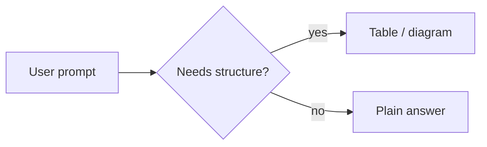
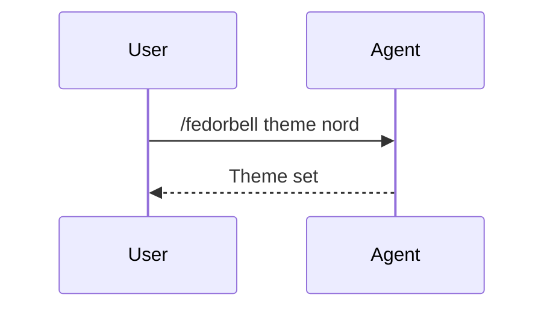

## Table

| Plugin part | Purpose | Loaded |
| --- | --- | --- |
| rules | always-on reply style | at start |
| skills | theme, setup, demo | on demand |

## Flowchart



## Sequence



## Figure

```text
before ──────▶ after
 plain         structured
```

## Callout

> [!NOTE]
> Callouts carry one caveat each.

## Math

$$ E = mc^2 $$
